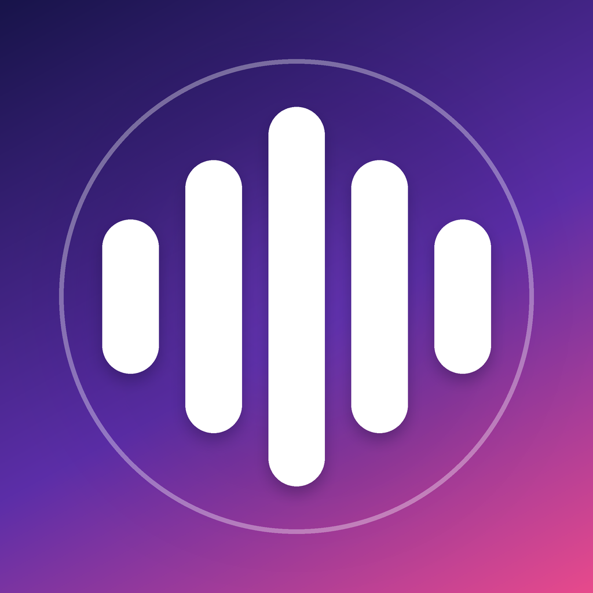
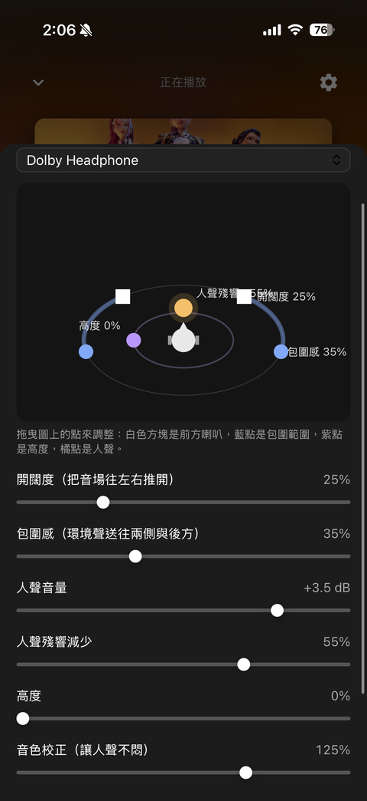
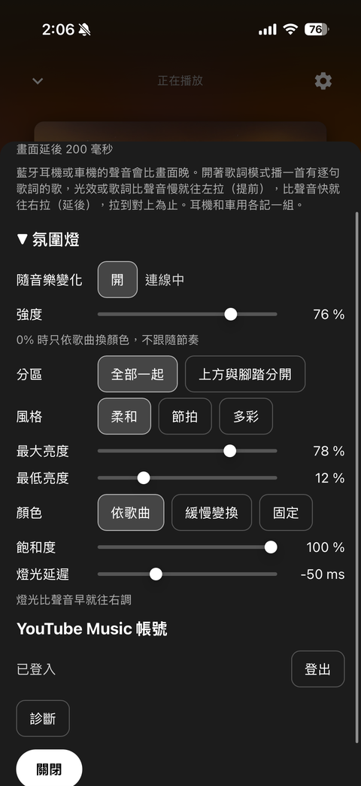

# Harmonia

**A YouTube Music player for iPhone**
Plays by itself without a PC, keeps playing with the screen off, shows on the lock screen and CarPlay

[繁體中文](README.md)

> **Read the [important notes](#important-notes) first**: turn off the car's original surround sound.
> **iPhone only.** There is no Android version (no APK). See [Android](#android).

## Contents

[Screenshots](#screenshots) ・ [Features](#features) ・ [Important notes](#important-notes) ・ [Install](#install-on-iphone) ・ [User guide](#user-guide) ・ [Problems](#problems) ・ [Android](#android) ・ [Build it yourself](#build-it-yourself) ・ [Legal](#legal)

---

## Screenshots

<table>
  <tr>
    <td align="center" width="50%">
       
      <b>Surround style</b> 
      Pick a headphone impulse-response style and drag the dots to shape the sound field: front speakers, spread, height, voice
    </td>
    <td align="center" width="50%">
       
      <b>Settings</b> 
      Picture and sound alignment, ambient light (folded), YouTube Music account, diagnostics; Close is at the bottom
    </td>
  </tr>
</table>

> Screenshots of Home, the player and History will be added later.

---

## Features

| Area | What it does |
| --- | --- |
| 🎵 **Playing** | Browse and search YouTube Music; [yt-dlp](https://github.com/yt-dlp/yt-dlp) runs inside the app, so no PC is needed |
| 📱 **Background and car** | Background playback, lock screen, Control Centre, CarPlay Now Playing |
| 🎧 **Sound** | Surround (headphone impulse responses), 5-band equaliser, loudness balancing |
| 🔀 **Automatic mixing** | Songs flow into each other; beat-matched when the tempos agree |
| 💾 **Downloads and history** | Keep songs on the phone; play history, also written to your YouTube Music history when signed in |
| 👤 **Account (optional)** | Your own home feed, likes and playlists |
| 💡 **Ambient light (optional)** | Drives a car ambient-light controller over Bluetooth LE from the music (needs a compatible controller) |

---

## Important notes

> [!IMPORTANT]
> **Turn off the car's original surround sound first.**
> Harmonia makes its own surround (headphone impulse responses) and equaliser. If the car stereo (or the headphones, or the phone) also has surround, sound field, 3D, Live, Dolby or spatial audio switched on, the sound is processed twice and can turn dull, smeared, hollow or distorted.
>
> - **Car stereo:** switch off the factory surround / sound field / virtual stage, and set its equaliser to flat (Off).
> - **Headphones and phone:** switch off the headphones' own enhancement and the phone's Spatial Audio.
> - Turn the volume down before you start, then raise it slowly.
> - The app's own **Surround** and **Equaliser & loudness** are yours to adjust; to listen without surround, switch **Surround** off in the player.

> [!WARNING]
> **Expires after 7 days.** An app sideloaded with a free Apple ID stops opening after 7 days and must be installed again (a paid developer account lasts a year).

> [!WARNING]
> **Terms of service and stability.** The app reads audio from YouTube with yt-dlp. That may be against YouTube's Terms of Service, and playback can stop working for a while when YouTube changes. Personal use only, at your own risk.

> [!NOTE]
> - **iPhone only.** There is no Android version (no APK).
> - **Sign in only on Google's own page.** Never type your account or password anywhere else.
> - **The ambient light is optional.** It only fits compatible car Bluetooth LE controllers; use it at your own risk, and ignore it if you do not need it.
> - **Check a log before you post it.** It lists the song ids and titles you played.
> - **The first song after each start** needs a few seconds to be looked up. That is normal.

---

## Install on iPhone

The app is **not** on the App Store. You install the `.ipa` from the [Releases](../../releases) page with a sideloading tool, using your own Apple ID.

| You need | Details |
| --- | --- |
| Phone | An iPhone on iOS 16 or later, a USB cable |
| Computer | A Windows PC or a Mac |
| Account | An Apple ID (a free one works, but the app expires after 7 days) |

### Option A - Sideloadly (Windows or macOS)

1. Install **iTunes** and **iCloud for Windows** from Apple's website (the Microsoft Store versions do not work with Sideloadly). On a Mac nothing extra is needed.
2. Install [Sideloadly](https://sideloadly.io/).
3. Download `YTMRemote.ipa` from the latest [release](../../releases/latest).
4. Connect the iPhone with the cable and tap **Trust** on the phone.
5. On the iPhone turn on **Developer Mode**: Settings > Privacy & Security > Developer Mode (the phone restarts). If you do not see it yet, do step 6 first and come back.
6. Open Sideloadly, drag the `.ipa` into it, choose your iPhone, type your Apple ID, press **Start** and enter your password when it asks. Type your credentials only into Sideloadly's own window.
7. On the iPhone: Settings > General > **VPN & Device Management** > your Apple ID > **Trust**.
8. Open the app.

<b>Option B - AltStore (Windows or macOS)</b> (click to open)

1. Install [AltServer](https://altstore.io/) on the computer and use it to install **AltStore** on the iPhone (follow AltStore's own guide).
2. Send `YTMRemote.ipa` to the iPhone (AirDrop, Files, or download it in Safari).
3. In AltStore open **My Apps**, tap **+** and pick the `.ipa`.
4. Do steps 5 and 7 from Option A (Developer Mode, Trust).
5. AltStore refreshes the app in the background while AltServer is running on your computer.

### First start

1. Pick a song from the home page. The first song after the app opens needs a few seconds to be looked up.
2. Optional: Settings > **YouTube Music account** > Sign in.
3. Optional: allow Bluetooth only if you use the ambient light.

---

## User guide

### The screen

Four tabs at the bottom; the gear opens **Settings**.

| Tab | What it does |
| --- | --- |
| **Home** (首頁) | YouTube Music's recommendations. Pull down to refresh; a message says how many new items came in, or that nothing changed |
| **Search** (搜尋) | Songs, albums, artists |
| **Downloads** (下載) | Songs stored on the phone; they play offline; play all or delete one by one |
| **History** (紀錄) | Play history, with two pages: "This phone" and "YouTube Music" |

### Playing

1. Tap any song. It joins the queue and the next one plays by itself.
2. The full player has the seek bar, previous / next, shuffle and repeat (off / all / one).
3. Playback continues with the screen off, in other apps, and on the lock screen or CarPlay Now Playing.
4. The automatic queue avoids other versions of the same song (official video, lyric video and so on).

### Sound

| Item | What it does |
| --- | --- |
| **Surround** | On/off and style (headphone impulse responses); drag the dots to shape the sound field |
| **Equaliser & loudness** | 5 bands (150 / 400 / 1500 / 5000 / 10000 Hz) and overall volume; loudness balancing keeps songs about equally loud |
| **Automatic mixing** | Songs flow into each other; a message tells you whether it is on |
| **Picture and sound alignment** (Settings) | If the backdrop light or the lyrics are behind the sound, drag left (earlier); if ahead, drag right (later); headphones and car are remembered separately |

<b>How automatic mixing works</b> (click to open)

The analysis runs entirely on the phone (the same method the PC used): it finds each song's tempo, beat positions, main part and ending. It mixes beat on beat when the tempos agree, and otherwise lets the next song come in as the ending fades. The next song must be downloaded first, so very short songs, or the first song after the app starts, are not mixed.

### Downloads

Tap **Download** (下載) in the player to keep a song on the phone; the button shows "downloading", "downloaded" or "retry". Manage them on the Downloads tab.

### Signing in (optional)

Settings > **YouTube Music account** > Sign in. When nobody is signed in, or the sign-in has expired, the app shows a sign-in prompt (you can choose Later; for "not signed in" also Do not remind me).

Once signed in:

- The home feed is your own.
- The heart in the player shows and changes your like, and songs can be added to playlists.
- Songs you heard for 30 seconds (half of a short one) are also written to your YouTube Music history (it may take a few minutes to show).

You type your Google credentials only on Google's own page; the app never sees them.

### Play history

- "This phone" is stored only on the phone (up to 500 songs; a song counts after 30 s, and repeats add to its count).
- **✕** on a row removes one entry; **Clear history** (清除紀錄) removes all after a second tap to confirm.
- "YouTube Music" shows your account's history and is read-only; sign in first.

### Ambient light (optional)

Settings > **Ambient light** (氛圍燈; folded by default, tap to open). Needs a compatible car controller (Bluetooth LE); Bluetooth permission is asked only when you switch it on. Choose the colour source (song cover, slow drift, fixed), the style (soft, beat, colourful), intensity and saturation. Ignore it if you do not need it.

---

## Problems

| Symptom | What to do |
| --- | --- |
| "Untrusted developer" | Settings > General > VPN & Device Management > Trust |
| The app closes right away, or shows no Developer Mode | Turn on Developer Mode (install step 5), then restart the phone |
| The app stopped opening after about a week | Free Apple IDs expire after 7 days: install it again |
| Sideloadly cannot find the iPhone | Reinstall iTunes (Apple's website version), unlock the phone, tap Trust |
| A song does not play | Wait about 10 seconds for the first lookup; update to the newest release (YouTube changes often) |
| Sound is dull, distorted or hollow | Switch off the car stereo's / headphones' / phone's own surround and spatial audio, see [Important notes](#important-notes) |

### Sending a log when you ask for help

Settings > **Diagnostics** (診斷) shows the current state and the latest log. To send the whole log, tap **three times with two fingers** and use **Share** or **Copy**. Read it before posting; it lists song ids and titles you played.

---

## Android

There is **no Android app and no APK**. The app uses iOS-only parts (the system audio engine, CarPlay, Bluetooth LE and an embedded Python runtime), so it cannot be repackaged. An Android version would be a separate project; contributions are welcome.

## Build it yourself

See [docs/DEVELOPMENT.md](docs/DEVELOPMENT.md). CI builds an unsigned ipa on every push; pushing a tag such as `v1.0.0` publishes it as a release.

## Legal

MIT licence, see [LICENSE](LICENSE) and [THIRD_PARTY_NOTICES.md](THIRD_PARTY_NOTICES.md). The app is not affiliated with YouTube, Google or Apple. Reading audio from YouTube may be against YouTube's Terms of Service; use it at your own risk and for personal use.
