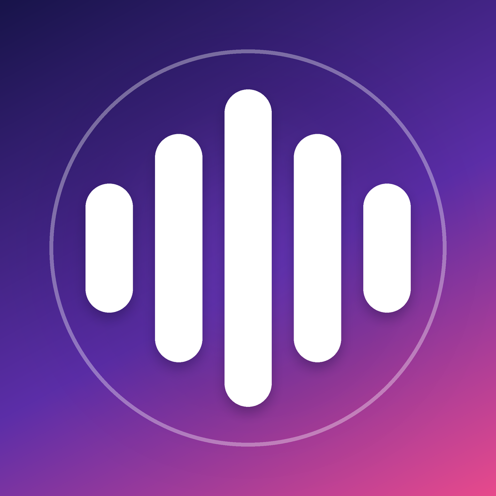
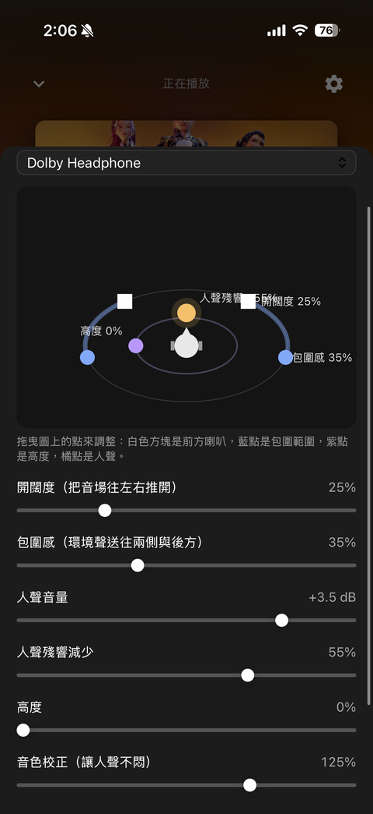
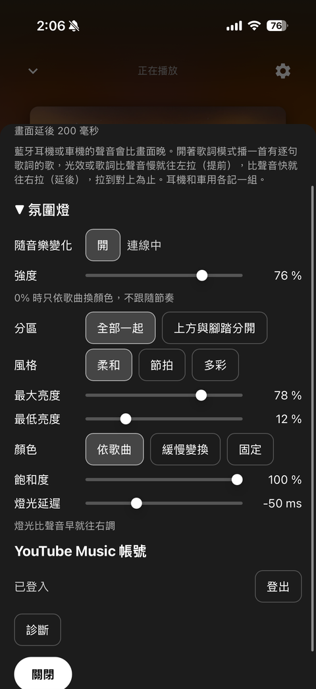

# Harmonia

**給 iPhone 的 YouTube Music 播放器**
不用電腦也能播，螢幕關閉持續播放，鎖定畫面與 CarPlay 都看得到

[English](README.en.md)

> **使用前請先看 [特別注意事項](#特別注意事項)**：車用請先關閉原車的環繞音效。
> **只有 iPhone**，沒有 Android 版（沒有 APK），詳見 [Android](#android)。

## 目錄

[畫面預覽](#畫面預覽) ・ [功能](#功能) ・ [特別注意事項](#特別注意事項) ・ [安裝](#在-iphone-上安裝) ・ [使用說明](#使用說明) ・ [常見問題](#常見問題) ・ [Android](#android) ・ [自行編譯](#自行編譯) ・ [法律](#法律)

---

## 畫面預覽

<table>
  <tr>
    <td align="center" width="50%">
       
      <b>環繞風格</b> 
      選擇耳機脈衝響應風格，拖曳圖上的點調整音場：前方喇叭、包圍範圍、高度、人聲
    </td>
    <td align="center" width="50%">
       
      <b>設定</b> 
      畫面與聲音對齊、氛圍燈（可摺疊）、YouTube Music 帳號、診斷，「關閉」在最下面
    </td>
  </tr>
</table>

> 首頁、播放頁、紀錄頁的截圖之後補上。

---

## 功能

| 類別 | 內容 |
| --- | --- |
| 🎵 **播放** | 瀏覽與搜尋 YouTube Music；App 內建 [yt-dlp](https://github.com/yt-dlp/yt-dlp)，自己播放，不需要電腦 |
| 📱 **背景與車載** | 背景播放、鎖定畫面、控制中心、CarPlay「正在播放」 |
| 🎧 **音效** | 環繞音效（耳機脈衝響應）、5 段等化器、音量平衡 |
| 🔀 **自動混音** | 歌曲之間自動疊接；速度相合時對拍 |
| 💾 **下載與紀錄** | 下載歌曲到手機；播放歷史；登入後也會同步到 YouTube Music 的歷史 |
| 👤 **帳號（選用）** | 登入後有自己的首頁、喜歡的歌曲、播放清單 |
| 💡 **氛圍燈（選用）** | 用藍牙 LE 讓車上的氛圍燈跟著音樂變化（需要相容的控制器） |

---

## 特別注意事項

> [!IMPORTANT]
> **請先關閉原車的環繞音效。**
> Harmonia 自己會做環繞（耳機脈衝響應）和等化。如果車機（或耳機、手機）同時也開著環繞、音場、3D、Live、Dolby、空間音訊之類的處理，聲音會被處理兩次，容易變得悶、糊、空洞或破音。
>
> - **車機：** 把原廠的環繞／音場／虛擬聲場關掉，等化器歸零或切到平直（Flat、Off）。
> - **耳機與手機：** 關掉耳機自帶的音效增強和手機的空間音訊（Spatial Audio）。
> - 開啟前先把音量調低，聽一下再慢慢調高。
> - App 內的「環繞」和「等化器與響度」是給你調整用的；不想要環繞時，直接在播放頁把「環繞」關掉。

> [!WARNING]
> **7 天過期。** 用免費 Apple ID 側載的 App 7 天後會打不開，需要重新安裝（付費開發者帳號為一年）。

> [!WARNING]
> **服務條款與穩定性。** 本 App 用 yt-dlp 從 YouTube 讀取音訊，可能違反 YouTube 服務條款，YouTube 改版後也可能暫時無法播放。僅供個人使用，風險自負。

> [!NOTE]
> - **只有 iPhone。** 沒有 Android 版（沒有 APK）。
> - **登入只在 Google 自己的頁面輸入。** 請不要把帳號或密碼輸入到任何其他地方。
> - **氛圍燈是選用功能。** 只適用於相容的車用藍牙 LE 控制器，使用風險自負，不用就不需要開。
> - **貼出紀錄前先檢查。** 紀錄裡有你播放過的歌曲 ID 和標題。
> - **每次開啟後的第一首歌**需要幾秒鐘查詢，這是正常的。

---

## 在 iPhone 上安裝

App **不在 App Store**。請到 [Releases](../../releases) 下載 `.ipa`，用側載工具和你自己的 Apple ID 安裝。

| 需要 | 說明 |
| --- | --- |
| 手機 | iOS 16 以上的 iPhone、USB 線 |
| 電腦 | Windows 電腦或 Mac |
| 帳號 | 一個 Apple ID（免費的可以用，但 7 天過期） |

### 方法 A：Sideloadly（Windows 或 macOS）

1. 到 Apple 官網安裝 **iTunes** 和 **iCloud for Windows**（Microsoft Store 版本不能搭配 Sideloadly）。Mac 不需要額外安裝。
2. 安裝 [Sideloadly](https://sideloadly.io/)。
3. 從最新的 [Release](../../releases/latest) 下載 `YTMRemote.ipa`。
4. 用線連接 iPhone，在手機上按「**信任**」。
5. 在 iPhone 開啟**開發者模式**：設定 > 隱私權與安全性 > 開發者模式（手機會重新啟動）。如果還看不到這個選項，先做第 6 步再回來。
6. 開啟 Sideloadly，把 `.ipa` 拖進去，選擇你的 iPhone，輸入 Apple ID，按 **Start**，需要時輸入密碼。帳號與密碼只輸入在 Sideloadly 自己的視窗。
7. 在 iPhone：設定 > 一般 > **VPN 與裝置管理** > 你的 Apple ID > **信任**。
8. 開啟 App。

<b>方法 B：AltStore（Windows 或 macOS）</b>（點一下展開）

1. 在電腦安裝 [AltServer](https://altstore.io/)，並用它把 **AltStore** 裝到 iPhone（照 AltStore 官方說明）。
2. 把 `YTMRemote.ipa` 傳到 iPhone（AirDrop、檔案 App，或用 Safari 下載）。
3. 在 AltStore 開啟 **My Apps**，點 **+**，選擇 `.ipa`。
4. 做方法 A 的第 5、7 步（開發者模式、信任）。
5. 只要電腦上的 AltServer 開著，AltStore 會在背景自動續期。

### 第一次使用

1. 在首頁選一首歌。App 開啟後的第一首歌需要幾秒鐘查詢。
2. 選用：設定 > **YouTube Music 帳號** > 登入。
3. 選用：只有要用氛圍燈時才需要允許藍牙。

---

## 使用說明

### 畫面總覽

底部有四個分頁，右上角的齒輪是**設定**。

| 分頁 | 做什麼 |
| --- | --- |
| **首頁** | YouTube Music 的推薦內容。往下拉可以更新，更新後會提示「已更新（N 項新內容）」或「內容和剛才相同」 |
| **搜尋** | 搜尋歌曲、專輯、歌手 |
| **下載** | 已存到手機的歌曲，離線也能播放；可以全部播放或逐首刪除 |
| **紀錄** | 播放歷史，分成「這支手機」和「YouTube Music 紀錄」兩個頁籤 |

### 播放

1. 點任何一首歌就開始播放，歌曲會加入佇列，自動接著播下一首。
2. 展開播放頁可以拖進度條、切換上一首／下一首、隨機播放、重複播放（關閉／全部／單曲）。
3. 螢幕關閉、切到別的 App、使用鎖定畫面或 CarPlay 的「正在播放」時都會繼續播放。
4. 自動接的歌會避開同一首歌的其他版本（官方影片、歌詞版等）。

### 音效

| 項目 | 說明 |
| --- | --- |
| **環繞** | 開或關；可選風格（耳機脈衝響應），也能拖曳調整音場 |
| **等化器與響度** | 5 段等化器（150 / 400 / 1500 / 5000 / 10000 Hz）和整體音量；音量平衡讓每首歌的大小接近 |
| **自動混音** | 歌曲之間自動疊接，開關會用提示告訴你目前狀態 |
| **畫面與聲音對齊**（設定） | 背景光效和歌詞比聲音慢就往左拉（提前），比聲音快就往右拉（延後）；耳機和車用各記一組 |

<b>自動混音是怎麼做的</b>（點一下展開）

分析完全在手機上做（和原本電腦端用的是同一套方法）：找出每首歌的速度、拍子位置、主要段落和結尾。速度相合時節拍對拍疊接，否則在結尾變小聲時讓下一首接進來。下一首要先下載完才會疊接，所以太短的歌或剛開始播的第一首不會混音。

### 下載歌曲

播放時按播放頁的「**下載**」，歌就會存到手機；按鈕會依狀態顯示「下載中」「已下載」或「重試下載」。到「**下載**」分頁管理。

### 登入 YouTube Music（選用）

設定 > **YouTube Music 帳號** > 登入。沒有登入、或登入失效時，App 會跳出登入提示（可選「稍後」，未登入的提示也可選「不再提醒」）。

登入後：

- 首頁變成你自己的推薦內容。
- 播放頁的愛心按鈕會顯示並更新這首歌是否已喜歡，也可以把歌加入播放清單。
- 聽滿 30 秒（短歌聽一半）的歌，會同步記到 YouTube Music 的歷史（可能有數分鐘延遲）。

帳號和密碼只輸入在 Google 自己的登入頁面，本 App 不會看到。

### 播放歷史

- 「這支手機」只存在手機上，最多 500 首；一首歌聽滿 30 秒（短歌聽一半）才會記錄，重複播放會累計次數。
- 每一筆右側的 **✕** 可以刪除單筆；上方的「**清除紀錄**」會刪除全部（要點兩下確認，第一下只是詢問）。
- 「YouTube Music 紀錄」是帳號上的歷史，只能讀取，需要先登入。

### 氛圍燈（選用）

設定 > **氛圍燈**（預設是收起來的，點一下展開）。需要相容的車用氛圍燈控制器（藍牙 LE）；第一次開啟時才會要求藍牙權限。可選顏色來源（依歌曲封面、緩慢變換、固定）、風格（柔和、節拍、多彩）、強度與飽和度。不用的話完全不需要理會。

---

## 常見問題

| 症狀 | 處理方式 |
| --- | --- |
| 「未受信任的開發者」 | 設定 > 一般 > VPN 與裝置管理 > 信任 |
| App 一開就關閉，或找不到開發者模式 | 開啟開發者模式（安裝教學第 5 步），再重新啟動手機 |
| 約一週後打不開 | 免費 Apple ID 7 天過期，重新安裝即可 |
| Sideloadly 找不到 iPhone | 重新安裝 Apple 官網版 iTunes、解鎖手機、按「信任」 |
| 歌曲播不出來 | 等約 10 秒（第一次查詢）；更新到最新 Release（YouTube 常常改版） |
| 聲音悶、破音、空洞 | 先關閉車機／耳機／手機自己的環繞與空間音訊，見 [特別注意事項](#特別注意事項) |

### 診斷與回報問題

設定最下方的「**診斷**」會顯示目前狀態和最近的紀錄。要把完整紀錄傳給別人：用**兩根手指在畫面上連點三下**開啟紀錄畫面，按 **Share** 或 **Copy**。貼出去前請先看過內容，裡面有你播放過的歌曲 ID 和標題。

---

## Android

**沒有 Android 版，也沒有 APK。** App 用到只有 iOS 才有的部分（系統音訊引擎、CarPlay、藍牙 LE、內嵌 Python），無法直接改打包。Android 版會是另一個獨立專案，歡迎貢獻。

## 自行編譯

見 [docs/DEVELOPMENT.md](docs/DEVELOPMENT.md)。每次 push 時 CI 會建出未簽名的 ipa；推送像 `v1.0.0` 這樣的 tag 會自動發佈成 Release。

## 法律

MIT 授權，見 [LICENSE](LICENSE) 與 [THIRD_PARTY_NOTICES.md](THIRD_PARTY_NOTICES.md)。本 App 與 YouTube、Google、Apple 無任何關聯。從 YouTube 讀取音訊可能違反 YouTube 服務條款，請自行承擔風險，且僅供個人使用。
